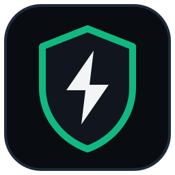

<p align="center">
  
</p>

<h1 align="center">TokenSafe</h1>
<!-- mcp-name: dev.tokensafe/tokensafe -->

<p align="center">
  <b>Local-First AI Guardrails, Focused Context &amp; Auditable Team ROI</b><br>
  Stop paying for AI hallucinations and secret leaks. Keep your team's coding agents focused on the right code, block exposed secrets before commit, and cut context bloat locally (up to <a href="METRICS.md">90%*</a>).<br>
  Built for teams using <b>Cursor, Claude Code, Codex, Windsurf, and Google Antigravity</b>.
</p>

<p align="center">
  <a href="https://github.com/tokensafe-dev/tokensafe/actions/workflows/test.yml"></a>
  <a href="https://www.npmjs.com/package/tokensafe"></a>
  <a href="https://www.npmjs.com/package/tokensafe"></a>
  <a href="https://pypi.org/project/tokensafe/"></a>
  <a href="https://github.com/tokensafe-dev/tokensafe/stargazers"></a>
  <a href="https://opensource.org/licenses/MIT"></a>
  <a href="https://tokensafe.dev#pricing"></a>
</p>

<p align="center">
  <a href="#1-click-universal-install">Install</a> &bull;
  <a href="#three-outcomes-for-engineering-teams">Outcomes</a> &bull;
  <a href="#tokensafe-guard-local-security-and-hygiene-shield">Guardrails</a> &bull;
  <a href="#universal-mcp-server-configuration">MCP Setup</a> &bull;
  <a href="#metrics-honesty">Metrics Honesty</a> &bull;
  <a href="#pricing-and-7-day-team-trial">Pricing</a> &bull;
  <a href="https://tokensafe.dev">Website &amp; Docs</a>
</p>

---

## 1-Click Universal Install

Connect TokenSafe to the AI coding agents on your workstation in one command:

```bash
# Option 1: Zero-Install via npx (Recommended for Cursor & Claude Desktop)
npx tokensafe

# Option 2: Python / PyPI
pip install tokensafe && tokensafe

# Option 3: Direct Shell Script (macOS / Linux)
curl -fsSL https://tokensafe.dev/install.sh | bash
```

On **Google Antigravity**, the installer additionally symlinks the plugin into `~/.gemini/config/plugins/agy-token-optimizer` — Antigravity loads it automatically on startup.

### Optional Dependency: `cryptography` (Recommended)

The local TokenSafe engine uses Python's standard library only and runs out of the box. One optional package, [`cryptography`](https://pypi.org/project/cryptography/), is installed automatically by `install.sh` and `requirements.txt` when available:

```bash
pip install cryptography   # or: brew install cryptography
```

| Component | With `cryptography` | Without (pure-stdlib fallback) |
|---|---|---|
| Client: license verification | Instant Ed25519 fast-path | Pure-Python Ed25519 (~0.3s once, then cached) |
| Client: everything else | Identical | Identical |
| Cloud backend: Clerk session tokens | RS256 signature verified | **Rejected** (fail-closed: unsigned tokens are never accepted) |
| Cloud backend: everything else | Identical | Identical |

The client caches a verified license for up to 1 hour, so even the pure-Python path adds no measurable latency after the first hook invocation.

---

## Universal Agent Hooks (Claude Code & Cursor)

Beyond MCP, TokenSafe installs native lifecycle-hook adapters inside your agent loop via `tokensafe setup`:

| Agent | Hook | What it does |
|---|---|---|
| **Claude Code** | `UserPromptSubmit` | Compacts the prompt into a TOCP S-expression and injects it as `additionalContext` (labeled *estimated* per [METRICS.md](METRICS.md)) |
| **Claude Code** | `PreToolUse` (Bash) | Blocks secret-bearing and destructive commands; prompts for confirmation on TLS-verification bypasses |
| **Cursor** | `beforeShellExecution` | Same shell guard: blocks secret leaks and destructive actions, asks on `-k` or `--insecure` |
| **Cursor** | `beforeReadFile` | Blocks raw lockfile, bundle, and `dist/` reads that would burn ~50k context tokens |
| **Codex CLI** | None yet | Uses MCP and `AGENTS.md` directly |

All adapters **fail open**: an internal error never stalls the host agent. Cursor's strict valid-JSON response contract is preserved on every error path.

## Context Budget HUD & Governor

Teams usually notice context exhaustion only when code quality drops mid-task. TokenSafe exposes live window usage as a native MCP tool:

```json
{ "tool": "tokensafe:context_budget", "args": { "model": "claude-x" } }
```

```json
{
  "window_tokens": 200000,
  "used_estimated": 168000,
  "used_pct": 84.0,
  "breakdown": { "tools": 165000, "history": 2300, "prompts": 700, "other": 0 },
  "threshold": "warning",
  "recommendation": "Context is heavy. Prefer tokensafe:smart_read_file ... and consider tokensafe:compact_conversation."
}
```

- **Window resolution**: explicit argument, then `TOKENSAFE_CONTEXT_WINDOW`, then model-family default (Gemini 1M, Claude 200k, GPT 128k).
- **80% session warning**: injected once per session by the `pre_invocation` hook when context usage approaches the threshold.
- **Cascading governor & prefix normalizer**: aligns prompt prefixes to 64-token boundaries (for Anthropic `cache_control` and DeepSeek caching) and progressively folds inactive bodies before overflowing.
- **Honest accounting**: counts only TokenSafe-instrumented flows and labels them `estimated` (a floor, never a fabricated total; see [METRICS.md](METRICS.md)).

## Per-Seat ROI & Persistent Diff-Aware Read-Cache

- **Per-Seat ROI (Team)**: the Team Seats dashboard table tracks saved tokens, derived USD impact, and the `measured` vs. `estimated` split per developer in one grouped query. Inactive seats show `—`, never guessed figures.
- **Diff-Aware Read-Cache (`SUBAGENT_DEDUP`)**: prevents subagent swarms from reading identical files repeatedly. Entries are keyed by **SHA-256 of raw file bytes**, so they survive MCP server restarts and `git checkout` while invalidating immediately on any real edit (bounded at 256k chars per artifact and 500 recent entries).

## Universal MCP Server Configuration

Connect TokenSafe to **Claude Desktop** (`claude_desktop_config.json`) or **Cursor** MCP settings:

```json
{
  "mcpServers": {
    "tokensafe": {
      "command": "npx",
      "args": ["-y", "tokensafe", "mcp"]
    }
  }
}
```

---

## Three Outcomes for Engineering Teams

Giving coding agents raw access to entire repositories creates three daily problems:
1. **Broken edits in large files**: reading 2,000-line modules for a 10-line fix causes models to forget imports, invent methods, and regress adjacent code.
2. **Secret leaks and unsafe shortcuts**: static prompt rules in `.cursorrules` wear off mid-session. Agents hardcode fallback credentials, disable TLS checks, or stage `.env` files with `git add .`.
3. **Mid-sprint quota stops and blind spend**: bloated diffs, lockfiles, and verbose MCP schemas burn 5-hour limits while engineering leads lack per-seat ROI visibility.

| Outcome | What changes for your team | Local enforcement |
|---|---|---|
| **Clean code on the first pass** | Agents read only target functions, design tokens, and 1-hop dependencies instead of 2,000 lines of noise. | Sub-30ms AST skeletonizer, `API_SURFACE.md` generator, predictive signature prefetcher, `git diff -U2` lockfile stripper, God Node detection, and Loop Guard. |
| **Zero leaked secrets in git** | Hardcoded password fallbacks, TLS bypasses, raw SQL interpolation, and `.env` commits are stopped before reaching disk or staging. | Deterministic `TokenSafe Guard`, Output Guard (`write_file >= 40 lines`), and local PII/key redaction. |
| **Predictable sprint velocity & ROI** | Shared L3 monorepo cache gives teammates warm 0ms hits, while CTOs receive a Friday ROI digest separating `measured` and `estimated` savings. | Three-tier cache (`L1` LRU, `L2` SQLite, `L3` Team pool), Token Arbitrage Guard (`< 100 tok` regex, `>= 100 tok` clamped to `60 tok`), and live SSE dashboard (`/api/events`). |

---

## Why Stripping Context Bloat Fixes AI Code Quality

TokenSafe started because of a **$400 monthly API bill** from running autonomous coding agents across active repositories.

Once engineering teams tested it, lower bills turned out to be the secondary benefit. **Agents wrote cleaner patches, stopped inventing non-existent methods, and stopped looping on the same broken fix.**

> Models rarely write bad code because they lack capability. They write bad code when 15,000 lines of irrelevant context drown out the few contracts that matter.

| What breaks coding agents | How TokenSafe fixes it | The outcome |
| :--- | :--- | :--- |
| **"Lost in the Middle" context fade**<br>An agent reads a 2,000-line file to change one 10-line helper, forgets imports, and invents methods. | **AST Skeletonizer** (`src/slicer.py`) folds inert bodies into typed signatures while keeping the target symbol and 1-hop callees intact. | **Focused signal.** The model keeps full type contracts without drowning in unrelated logic. |
| **Terminal log flooding**<br>`npm test` or `pytest` fails and dumps 4,000 lines of stack traces and lockfile diffs into context. | **Command Sanitizer** (`src/command_sanitizer.py`) strips lockfile noise and trims output to the failing assertion and stack frame. | **Root-cause fixes.** The agent repairs the actual bug instead of rewriting unrelated files. |
| **5-attempt retry loops**<br>An agent repeats the same broken edit five times in a row until the context budget runs dry. | **Loop Guard** (`src/loop_detector.py`) detects repeated identical tool calls and halts the cycle. | **Fewer regressions.** Stuck loops stop before damaging working modules. |
| **Verbose prompts & token arbitrage**<br>Loose phrasing like *"fix auth without breaking cache"* leads to wide, risky rewrites. | **TOCP Intent Compactor** (`src/compactor.py`) distills instructions into compact S-expressions (`-40% to -70%`) with strict scope bounds. | **Clear scope.** Example: `(DEBUG auth.ts [jwt] "fix 401 token expiry")`. |
| **Unsafe edits & secret leaks**<br>An agent hardcodes fallback keys, sets `verify=False`, builds SQL with f-strings, or runs `git add .` with `.env` present. | **TokenSafe Guard** (`src/guard.py`) audits writes and shell commands locally before execution. | **Protected repositories.** Credentials, SQLi patterns, and destructive commands are blocked locally. |

---

## Polyglot AST Engine (10+ Languages)

TokenSafe supports modern polyglot monorepos out of the box. Its deterministic local AST state machine folds non-target function bodies in **< 30ms** with zero external runtime dependencies, while preserving target symbols and 1-hop dependencies with full executable bodies.

### Supported Language Matrix

| Language / Framework | File Extensions | Preserved Structures | Folding Mechanism |
|---|---|---|---|
| **TypeScript / React** | `.ts`, `.tsx`, `.js`, `.jsx`, `.mjs`, `.cjs` | React components (`React.FC`, `memo`, `forwardRef`, multi-line destructuring), arrow functions, hooks, classes, interfaces | Target & 1-hop bodies kept full; non-target bodies folded into `{ /* ... */ };` |
| **Python** | `.py` | Classes, typed signatures, docstrings, decorators, `async def` | Native `ast.parse` tree pruning with `...` body replacement |
| **Go** | `.go` | Struct declarations, interfaces, methods `func (r *Recv) Method(...)`, generics `func Map[T any]` | Non-target functions folded; struct layouts and `select` blocks preserved |
| **Rust** | `.rs` | `struct`, `enum`, `impl` blocks, `trait` blocks, `pub(crate) async fn`, `const fn` | `impl` containers stay open; method bodies folded into `{ /* ... */ }` |
| **Java & C#** | `.java`, `.cs` | Classes, records, methods with access modifiers (`public`, `protected`, `static`, `async`, `override`), generic return types (`Task<T>`, `List<E>`), `throws` | Method bodies folded; classes and interfaces remain structural |
| **C & C++** | `.c`, `.cpp`, `.cc`, `.cxx`, `.h`, `.hpp` | Classes, structs, namespaces, scoped methods `ClassName::method`, `const`, `noexcept`, `override`, destructors | Functions folded; namespace and class hierarchies preserved |
| **PHP, Kotlin, Swift** | `.php`, `.kt`, `.kts`, `.swift` | Classes, `function`, `fun`, `func` declarations with visibility modifiers | Function bodies folded into `{ /* ... */ }` |
| **CSS, SCSS, LESS, Tailwind** | `.css`, `.scss`, `.sass`, `.less` | **Design tokens (`:root`, `@theme`, CSS variables, `$var`, `@var`) preserved in full**, container queries (`@media`, `@supports`, `@container`, `@layer`) kept open | Component selectors, `@keyframes`, and mixins folded into `{ /* ... */ }` unless matching `target_symbol` |

### Key Engine Guarantees
- **Design Token & Palette Preservation**: When skeletonizing stylesheets, TokenSafe keeps design tokens (`:root { ... }`, Tailwind v4 `@theme { ... }`, CSS variables `--*`, SCSS `$vars`) intact so agents never invent colors, radii, or font rules.
- **Strict Arrow Function Parser**: Arrow functions require `=>` before any `{` counts as a function body. Destructuring parameters (`({ a, b }: Props) =>`) and parenthesized ternary expressions (`const x = (flag) ? { a: 1 } : { b: 2 }`) are left intact.
- **Directory Tree Optimization (`tokensafe:list_dir`)**: Replaces verbose `ls -la` output with a compact, depth-bounded tree without permissions, timestamps, or lockfiles.
- **Graph-Guided Neighborhood Slicing**: Calling `tokensafe:smart_read_file(path, symbol="Target")` preserves the target body **and its 1-hop callees/callers** while folding unrelated code.
- **Comment & String Bracket Immunity**: Multi-line block comments (`/* ... */`, JSX `{/* ... */}`), template strings (`` `${...}` ``), and escaped quotes are tracked by `BraceLexer` so brackets never desynchronize.
- **Control-Flow Immunity**: Statements like `if (...)`, `catch (err) {`, `for (...)`, and `while (...)` are protected from folding.

---

## The Hidden Context Tax: MCP Tool Schema Bloat

Coding agent quotas (such as 5-hour session windows or monthly token budgets) often drain after a few prompts before real work starts.

### The Hidden System Prompt Tax
Whenever an MCP server is enabled in an editor (Cursor, Claude Desktop, Antigravity, Windsurf), **the full JSON schema for every tool is injected into the system prompt on every turn**, even when unused:

```text
┌────────────────────────────────────────────────────────────────────────┐
│  SYSTEM PROMPT ANATOMY (EVERY SINGLE TURN)                            │
├────────────────────────────────────────────────────────────────────────┤
│  Base System Instructions                                ~1,500 tokens │
│  Active Workspace Skills & Prompts                       ~8,000 tokens │
│  Regular MCP Tools (context7, prisma, etc.)                ~800 tokens │
│  [!] Heavy MCP Tools (200+ schemas from large servers)   ~6,000 tokens │
├────────────────────────────────────────────────────────────────────────┤
│  TOTAL HIDDEN BASE TAX BEFORE YOUR FIRST LINE OF CODE:                 │
│  ~16,300 tokens PER TURN x 15 turns = 244,500 tokens burned            │
└────────────────────────────────────────────────────────────────────────┘
```

- **1 server with 50 tools** = **~1,500 to 2,500 tokens** of static tax per turn.
- **1 server with 200+ tools** = **~5,000 to 10,000 tokens** per turn.
- Across a 15-turn coding session, **75,000 to 150,000 tokens** go solely to tool schemas.

### How TokenSafe Cuts MCP Overhead
1. **`tokensafe doctor` (Environment Auditor)**: Scans configured MCP servers and skills, measures token overhead per turn, and flags servers with $\ge 40$ tools as `CRITICAL BLOAT`.
2. **1-Click MCP Toggle**: Enable or disable heavy servers without manual JSON edits:
   ```bash
   tokensafe mcp disable rea     # Prunes heavy schemas from the system prompt
   tokensafe mcp enable rea      # Re-enables when needed
   ```
3. **Session Start Bloat Alerts**: Surfaces warning badges in chat when heavy MCP bloat is active.
4. **Telemetry Retention (`tokensafe prune` / `vacuum`)**: Compacts SQLite metrics with rolling-window rollups, reducing local database footprint by up to 40%.

---

## TokenSafe vs. Graphify: In-Flight Defense vs. Static Reports

How TokenSafe complements or replaces static graph tools like **Graphify** (`graphify-labs/graphify`):

| Capability | Graphify | TokenSafe |
|---|---|---|
| **Primary Focus** | Static knowledge graph reports & MCP queries | **In-flight real-time context slicing & security guardrails** |
| **Indexing Cost** | Requires LLM tokens / offline graph build | **0 tokens, deterministic local AST (< 30ms)** |
| **Execution Latency** | Offline CLI build step | **Sub-millisecond inline proxy & lifecycle hooks** |
| **Active Slicing** | Static report (`GRAPH_REPORT.md`) | **Dynamic call-graph skeletonization (85% to 92% fewer file tokens)** |
| **Multi-Project Workspace** | Manual directory targeting | **Detects project roots per file on the fly** |
| **Prompt Distillation** | None | **TOCP S-expression compaction (-40% to -70%)** |
| **Safety & Runaway Prevention** | None | **Guardrails, Output Guard, Loop Guard, secret redaction** |

> **Complements & Replaces**: If you already maintain Graphify reports for architecture docs, TokenSafe still slices live file reads on the wire. Standalone, TokenSafe needs no pre-indexing step.

---

## TokenSafe Guard: Local Security and Hygiene Shield

Coding agents hold shell execution and file write access across your repositories. Passive prompt rules fade over multi-turn sessions, leaving code vulnerable to leaked keys, TLS bypasses, or unsafe staging.

**TokenSafe Guard** (`src/guard.py`) audits tool calls locally before disk or git execution with zero token overhead:

### 1. Secret & Private Key Leak Prevention (Zero Hardcoded Fallbacks)
- **Live Provider Secrets**: Blocks hardcoded Stripe live keys, AWS access keys, OpenAI project keys, Anthropic tokens, and GitHub personal access tokens.
- **Default Fallback Hardcoding**: Rejects non-placeholder defaults such as `os.environ.get("DB_PASSWORD", "prod_secret_123")` or `process.env.JWT_SECRET || "production_secret"`.
- **Raw Private Keys**: Blocks 64-character raw hex keys and raw PEM private key blocks in source files.

### 2. Insecure SSL/TLS Verification Bypass Shield
- Blocks `verify=False` in Python (`requests`, `httpx`, `aiohttp`, `urllib3`) and `rejectUnauthorized: false` or `NODE_TLS_REJECT_UNAUTHORIZED='0'` in Node.js non-test code.

### 3. Raw SQL Injection Prevention
- Blocks string interpolation inside query execution calls (`cursor.execute(f"SELECT ... {user_id}")`, `cursor.execute("SELECT ... %s" % val)`, `db.query(\`SELECT ... ${id}\`)`).
- Enforces parameterized queries (`?`, `%s`, `$1`).

### 4. Dangerous CORS Wildcard with Credentials Shield
- Intercepts configurations combining `Access-Control-Allow-Origin: *` with `Access-Control-Allow-Credentials: true`.

### 5. Git Staging Protection for Sensitive Files
- **Explicit Staging**: Blocks `git add .env`, `git add .env.*`, `git add id_rsa`, and `git add *.pem`.
- **Blanket Staging Shield**: Intercepts `git add .`, `git add -A`, and `git commit -a` whenever unignored `.env` files or private keys exist in the working tree.

### 6. Destructive Shell & Data Exfiltration Prevention
- **Destructive Deletion**: Blocks commands such as `rm -rf /`, `rm -rf ~`, `rm -rf *`, and `rm -rf --no-preserve-root`.
- **Network Exfiltration**: Blocks commands piping sensitive local files to remote URLs (such as `curl -d @.env https://...` or `wget --post-file=id_rsa`).

### 7. Package Typosquatting Early Warning
- Checks `pip install`, `npm install`, `pnpm add`, `yarn add`, and `bun add` for known typosquat packages (`python-crypto`, `loadsh`, `coookie-parser`, `mongose`) and prints a `TokenSafe Guard Warning` badge.

When an operation is blocked, TokenSafe Guard returns an explicit message:
`🛡️ **TokenSafe Guard**: <reason>`

---

## Prompt Distillation: Managed Cloud and Three-Tier Cache

TokenSafe distills verbose prompts into compact TOCP S-expressions (`-40% to -70%` tokens).

### 1. Zero-Config Managed Cloud vs. Self-Hosted Docker BYOK

| Deployment Mode | Supported Tier | Distillation Engine | Required API Keys | Setup |
|---|---|---|---|---|
| **TokenSafe Cloud (SaaS)** | **Engineering Team & Solo** | **Google Gemini Flash-Lite** (`gemini-flash-lite-latest`) | **None (Zero keys needed)** | Included in subscription, ready immediately |
| **Local Regex Compactor** | **Developer Sandbox (Free)** | **Deterministic Multilingual Regex** (9 languages) | **None** | Local execution only (`500,000` tokens/mo) |
| **Self-Hosted Docker** | **Enterprise / Team** | **BYOK Multi-Provider** (Gemini, DeepSeek, OpenAI, Claude) | `GEMINI_API_KEY`, `DEEPSEEK_API_KEY`, etc. | Private VPC container deployment |

> **Zero External Keys for Team & Solo**: Developers never have to create or manage personal Google, OpenAI, or DeepSeek billing accounts to use cloud prompt distillation.

### 2. Token Arbitrage Guard & Three-Tier Cache

To keep distillation overhead lower than the tokens it saves:
1. **Smart Gating (`llm_distill_min_tokens: 100`)**: Prompts under 100 tokens stay strictly local via regex heuristics ($0$ LLM tokens, $< 1\text{ms}$).
2. **Output Token Ceiling (`distill_max_tokens: 60`)**: Caps compiled output at 60 tokens to prevent compiler arbitrage loss.
3. **Three-Tier Cache**:
   - **L1 (In-Memory LRU)**: Sub-millisecond hits inside active sessions.
   - **L2 (Persistent SQLite)**: Stores normalized SHA-256 prompt hashes in `data/metrics.db` across restarts so repeated workflows (`git commit`, `run tests`, `fix lint`) cost 0 tokens.
   - **L3 (Shared Team Cache)**: *Team Tier.* Syncs distilled intents and AST skeletons across teammates and CI runners (`/api/team/cache`) for warm 0ms team cache hits.

### 3. Provider & Cache Inspection

Inspect your active license tier, distillation mode, and cache stats anytime:
```bash
tokensafe providers
```

For self-hosted Docker environments (`TOKENSAFE_SELF_HOSTED=1`), configure providers in `data/config.json`:
```json
{
  "preferred_provider": "gemini",
  "gemini_api_key": "YOUR_GEMINI_API_KEY",
  "gemini_model": "gemini-flash-lite-latest",
  "llm_distill_min_tokens": 100,
  "distill_max_tokens": 60
}
```

---

## Calibrated SWE-bench Benchmark Results

Reference run across 8 production engineering scenarios (`131,552` baseline tokens down to `7,263` tokens, `-94.5%` net token reduction, `+28.1%` turn latency speedup with `100%` accuracy retention):

> Token counts vary by ±1% between runs because prompt compaction is **measured live** on every run while baseline sizes are modeled constants. See [METRICS.md](METRICS.md) for the full simulation disclosure and measured-vs-modeled breakdown.

| Benchmark Scenario | Task Complexity | Baseline Tokens | TokenSafe Tokens | Reduction | Turn Speedup | Accuracy |
|---|---|---|---|---|---|---|
| **Zero-Token Architecture Discovery** | Full repo God Node indexing | 49,716 | **486** | **-99.0%** | **6 ➔ 1 turns (+83%)** | 100% Pass |
| **Graph-Guided AST Symbol Slicing** | Target function + 1-hop callees | 8,016 | **451** | **-94.4%** | **4 ➔ 2 turns (+50%)** | 100% Pass |
| **Monorepo Lockfile Grep Leak** | `git grep` across lockfiles | 10,111 | **491** | **-95.1%** | 2 turns | 100% Pass |
| **Monorepo Lockfile Git Diff** | Monorepo branch diff | 18,911 | **761** | **-96.0%** | 2 turns | 100% Pass |
| **Multi-Turn History Compaction** | 8-turn session history fold | 31,010 | **3,130** | **-89.9%** | 8 turns | 100% Pass |
| **Race Condition / Distributed Lock** | AST query & Redis redlock | 5,074 | **404** | **-92.0%** | **4 ➔ 3 turns (+25%)** | 100% Pass |
| **OAuth JWT Expiration Triage** | Controller bug investigation | 3,757 | **401** | **-89.3%** | **3 ➔ 2 turns (+33%)** | 100% Pass |
| **CI Test Failure Extraction** | Full test log & stack trace | 5,009 | **1,127** | **-77.5%** | 3 turns | 100% Pass |

> **How to read these numbers:** This benchmark is a **simulated** harness. Compression ratios are real, deterministic tool-output deltas on real files, while the "turn speedup" column models agent behavior. Production events in TokenSafe are explicitly labeled `measured` or `estimated` (see [METRICS.md](METRICS.md)).

---

## Metrics Honesty

TokenSafe labels every savings event as one of:

- **`measured`**: the model literally received fewer bytes than the tool produced (sliced file reads, filtered command output, AST skeletons).
- **`estimated`**: the model received a compact artifact and saved tokens are counted against a reasonable baseline (architecture graph vs. a full repo crawl; folded history digest injected while raw history stays in context).

Totals on the dashboard and landing page always display the split (`X metered · Y est.`). When a live metric is missing, the UI shows `—` rather than a placeholder number. USD figures are derived approximations (`tokens × $1.5 / 1M`), not provider invoices. Full contract: **[METRICS.md](METRICS.md)**.

---

## Pricing and 7-Day Team Trial

TokenSafe follows an open-core model: verify local context savings and guardrails on your own repo first, then roll out team caching, org policies, and per-seat ROI.

| Plan | Price | Monthly Allowance | Included Capabilities |
|---|---|---|---|
| **Developer Sandbox** | **$0** forever | **500,000 tokens / mo** | 9-Language Local Regex Compactor, Local AST Slicer CLI, Local Secret & `.env` Guard, SQLite & Terminal Dashboard |
| **Engineering Team** *(Recommended)* | **$29 / seat / mo** *(~$24 / seat / mo billed $290/yr)* | **Unlimited** | **7-Day Free Trial**, **Shared Team Cache (L3 Monorepo Hits)**, Org-Wide Guard & Git Leak Shield, Friday Per-Seat ROI Digest, Centralized Ed25519 Seat Provisioning & Revoke, Managed Cloud Distillation (zero keys needed) |
| **Enterprise & VPC** | **Custom** | **Unlimited** | Self-Hosted Docker VPC Proxy (Private BYOK), Zero-Telemetry / Air-Gapped Mode, SAML SSO, Custom Guard Policies & SLA |

*Working solo? [Individual Solo plans](https://tokensafe.dev#pricing) start at **$9 / mo** ($89 / yr).*

**[Start a 7-Day Team Trial](https://tokensafe.dev#pricing)**

---

## CLI Quickstart

```bash
# View live savings dashboard in your terminal
tokensafe stats
```

```text
┌────────────────────────────────────────────────────────────────────────┐
│               ⚡ TOKENSAFE CONTEXT OPTIMIZER DASHBOARD ⚡               │
└────────────────────────────────────────────────────────────────────────┘

Total Tokens Saved:   4,524,156 tokens
Efficiency Gain:      [████████████████████████████░░] 92.5%
Estimated Savings:    $6.7865 USD
Context Traffic:      4,889,255 raw ➔ 370,574 optimized (2132 events)

── Breakdown by Source ──────────────────────────────────────────────────
• AST Skeletonizer (Signatures)       :   3,509 tokens saved (2 events)
• Command Sanitizer (CLI)             : 727,300 tokens saved (263 events)
• Context Governor                    :   5,800 tokens saved (29 events)
• Graph-Guided Slicer (Call-Graph)    :  42,420 tokens saved (14 events)
• Architecture Graph (God Nodes)      : 758,256 tokens saved (13 events)
• Multi-turn History Fold             : 2,897,897 tokens saved (471 events)
• Output Token Guard (write_file)     :  42,466 tokens saved (84 events)
• Prompt Compactor (TOCP + Cache)     :  43,502 tokens saved (1255 events)
• File Line Slicer (AST)              :   3,006 tokens saved (1 events)

Run `tokensafe test "<prompt>"` to test compression on custom input.
Run `tokensafe html` to view interactive browser dashboard.
```

```bash
# Open interactive local dark-mode browser dashboard
tokensafe html

# Export a markdown savings report
tokensafe markdown

# Test prompt compression on custom input in real time
tokensafe test "please fix the validate_token method in src/auth.py so that it checks jwt expiration and returns boolean"

# Audit environment and context token tax (MCP & skills)
tokensafe doctor

# List configured LLM distillation providers and models
tokensafe providers

# Analyze repository God Nodes and dependency topology
tokensafe graph

# Generate compact tokensafe-out/API_SURFACE.md interface snapshot
tokensafe map

# Manage or disable high-overhead MCP tools
tokensafe mcp list
tokensafe mcp disable <server>
tokensafe mcp enable <server>

# Optimize SQLite metrics storage
tokensafe vacuum
tokensafe prune

# Generate or preview Friday team ROI digest email
tokensafe digest

# Run the SWE-bench verification suite
tokensafe benchmark

# Run the local transparent AI proxy (0.0.0.0:8765/v1)
tokensafe proxy

# Activate your Team or Solo license key (TS2 Asymmetric Ed25519 Key)
tokensafe activate TS2.eyJlbWFpbCI6...
```

---

## Docker Deployment (Multi-Provider Support)

TokenSafe ships with a hardened multi-stage production Docker image, non-root execution (`uid: 1000`), and multi-provider LLM routing.

### 1. Multi-Provider Environment Keys

Configure any preferred LLM provider keys for self-hosted deployments:

| Environment Variable | Provider Supported | Default Model |
|---|---|---|
| `GEMINI_API_KEY` | Google Gemini (Lowest cost & latency) | `gemini-flash-lite-latest` |
| `PREFERRED_PROVIDER` | Explicit provider priority (`gemini`, `deepseek`, etc.) | `gemini` |
| `DEEPSEEK_API_KEY` | DeepSeek API | `deepseek-chat` |
| `OPENAI_API_KEY` | OpenAI API | `gpt-4o-mini` |
| `ANTHROPIC_API_KEY` | Anthropic Claude | `claude-3-5-haiku-20241022` |
| `TOKENSAFE_UPSTREAM_KEY` | Unified / Custom Gateway | Custom Upstream |

### 2. Docker Compose Quickstart

Run TokenSafe as a centralized team gateway:

```yaml
version: '3.8'

services:
  tokensafe:
    build:
      context: .
      dockerfile: Dockerfile
    container_name: tokensafe
    restart: unless-stopped
    ports:
      - "8765:8765"
    environment:
      - TOKENSAFE_HOST=0.0.0.0
      - TOKENSAFE_PORT=8765
      - TOKENSAFE_DATA_DIR=/app/data
      # Choose your provider(s):
      - DEEPSEEK_API_KEY=${DEEPSEEK_API_KEY:-}
      - OPENAI_API_KEY=${OPENAI_API_KEY:-}
      - ANTHROPIC_API_KEY=${ANTHROPIC_API_KEY:-}
      - GEMINI_API_KEY=${GEMINI_API_KEY:-}
      - TOKENSAFE_LICENSE_KEY=${TOKENSAFE_LICENSE_KEY:-}
    volumes:
      - ./data:/app/data
    healthcheck:
      test: ["CMD", "python3", "-c", "import urllib.request; urllib.request.urlopen('http://127.0.0.1:8765/api/health')"]
      interval: 30s
      timeout: 5s
      retries: 3
```

Start the container in detached mode:
```bash
docker compose up -d
```

### 3. Verification & Live SSE Streaming

- **Health check**: `curl http://localhost:8765/api/health`
- **Live SSE Event Stream**: `curl -N http://localhost:8765/api/events`
- **Point your AI Agents**: Configure your IDE or agent to use `http://localhost:8765/v1` as the upstream base URL.

---

## Security Architecture & Cloud API Endpoints

TokenSafe Cloud Backend enforces strict zero-trust boundaries across client and server requests:

### 1. Cryptographic Authentication & Licensing
- **Asymmetric RFC 8032 Ed25519 Signatures (`TS2.*`)**: Client instances verify digital signatures offline using an embedded 32-byte public key. The private signing key never leaves the cloud environment.
- **JWT Session Tokens**: Cloud endpoints verify sessions via HS256 JWT bearer tokens or Clerk session tokens.
- **Dual Bearer Support**: Client endpoints accept either a signed license key (`TS2.*` / `TS1.*`) or a JWT in `Authorization: Bearer <token>`.
- **Zero Hardcoded Secrets**: all server credentials load strictly from runtime environment variables — nothing is hardcoded in the codebase.

### 2. Cloud API Endpoint Reference

| Method | Endpoint | Auth Required | Headers / Parameters | Description |
|---|---|---|---|---|
| `GET` | `/api/health` | Public | None | Healthcheck and service version status. |
| `GET` | `/api/events` | Public | SSE `text/event-stream` | Real-time Server-Sent Events stream for live dashboard telemetry. |
| `GET` | `/api/dashboard` | **Bearer Auth** | `Authorization: Bearer <jwt\|key>` or `?license=<key>` | Authenticated user metrics, token savings, and license status. |
| `GET` | `/api/digest/preview` | **Bearer Auth** | `Authorization: Bearer <jwt\|key>` or `?team_id=<id>` | Previews current weekly team ROI digest (HTML / JSON). |
| `POST` | `/api/team/seat/create` | **Bearer Auth** | `Authorization: Bearer <jwt\|key>`, JSON `{ owner_email, member_email }` | Generates a cryptographically signed seat license for a team member. |
| `POST` | `/api/team/seat/revoke` | **Bearer Auth** | `Authorization: Bearer <jwt\|key>`, JSON `{ owner_email, license_key }` | Revokes an active team seat license key. |
| `POST` | `/api/telemetry/sync` | **License Auth** | JSON `{ license_key, email, events: [...] }` | Syncs batch telemetry events (enforces max 50 events/batch). |

Seat and license management is available through the [dashboard](https://dashboard.tokensafe.dev). Privacy controls (e.g. `TOKENSAFE_TELEMETRY_DISABLED=1` to disable cloud telemetry sync) are documented in [METRICS.md](METRICS.md).

---

## Unit Testing

```bash
python3 -m unittest discover tests
```
*Zero mandatory runtime dependencies: runs on standard Python 3.10+. The optional `cryptography` package (`requirements.txt`) accelerates Ed25519 license verification and enables fail-closed RS256 Clerk verification on the cloud backend.*

---

## License
MIT License. Commercial licenses are available for self-hosted B2B and enterprise VPC deployments.

---

## Project Structure

```text
agy-token-optimizer/
├── plugin.json                 # Antigravity plugin manifest
├── hooks.json                  # Lifecycle hook declarations (PreInvocation, PreToolUse, PostToolUse)
├── Dockerfile                  # Hardened multi-stage container deployment
├── docker-compose.yml          # Production Docker compose with multi-provider routing
├── rules/
│   └── AGENTS.md               # TOCP Protocol directives for LLM (prompt-cached)
├── skills/
│   └── token-optimizer/
│       └── SKILL.md            # On-demand Antigravity skill
├── proto/
│   └── tocp.proto              # Protocol Buffers contract
├── src/
│   ├── cli.py                  # Unified CLI dispatcher (npm, pip, standalone)
│   ├── cache_normalizer.py     # Prompt Cache Prefix Normalizer (Anthropic & DeepSeek)
│   ├── governor.py             # Context Window Governor & Token Ceiling (Cascading reduction)
│   ├── agent_firewall.py       # Cross-Agent Deduplication Cache (Subagent Firewall)
│   ├── diff_slicer.py          # AST Diff Slicer & Lockfile Stripper (`git diff -U2`)
│   ├── weekly_digest.py        # Friday Team ROI Digest & Engineer Leaderboard
│   ├── environment_auditor.py  # MCP Server & Skill context token tax auditor
│   ├── command_sanitizer.py    # High-output terminal command sanitizer
│   ├── proxy.py                # Multi-provider transparent AI proxy & SSE broadcaster
│   ├── graph_engine.py         # Sub-30ms AST parser, call graphs & God Node centrality
│   ├── tokenizer.py            # Zero-dependency calibrated BPE token counter
│   ├── compactor.py            # Semantic compactor (Local Regex + Distillation -> TOCP S-Expr)
│   ├── distiller.py            # Multi-provider LLM distillation engine (Gemini, DeepSeek, OpenAI)
│   ├── distiller_cache.py      # Two-tier LRU + SQLite prompt distillation cache
│   ├── deepseek_distiller.py   # DeepSeek-Flash semantic compiler with token arbitrage guard
│   ├── slicer.py               # AST & Line windowing tool optimizer
│   ├── metrics.py              # Persistent SQLite metrics engine
│   ├── dashboard.py            # Visual ANSI terminal, Markdown & reactive SSE web dashboard
│   ├── license_manager.py      # Ed25519 cryptographic license verification
│   ├── mailer.py               # Transactional email & Friday ROI digest dispatcher
│   ├── mcp_server.py           # Native Model Context Protocol (MCP) server
│   ├── installer.py            # Multi-IDE agent auto-installer & config wizard
│   └── cloud_backend.py        # Cloud REST backend & team telemetry API
├── hooks/
│   ├── pre_invocation.py       # PreInvocation hook entry point
│   ├── pre_tool_use.py         # PreToolUse hook entry point
│   └── post_tool_use.py        # PostToolUse hook entry point
├── frontend/                   # React / Vite / Tailwind Web App & Dashboard
├── bin/
│   ├── tokensafe.js            # Node.js npm launcher (npx tokensafe)
│   └── tokensafe               # Python CLI launcher (pip / standalone)
├── tests/                      # Unit test suite
├── install.sh                  # One-click installer for Antigravity
└── README.md
```
